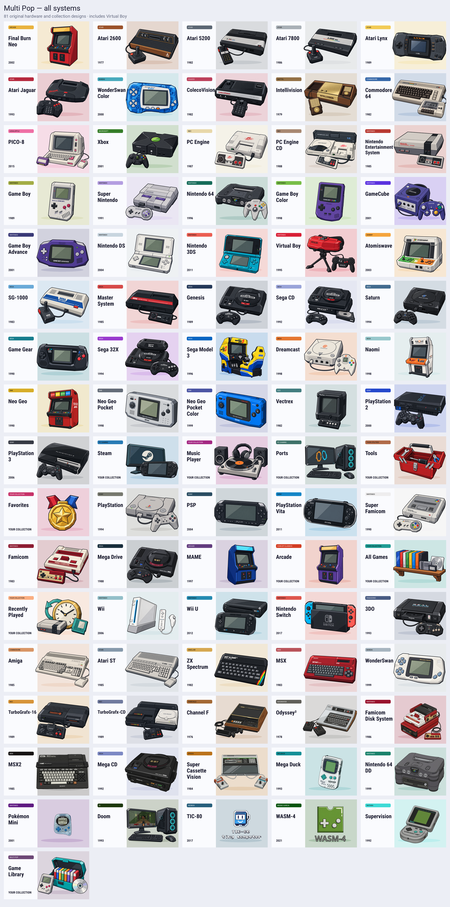

# Multi Pop Thor

> **AI disclosure:** This theme was developed with the help of AI, and its original system illustrations were AI-generated. Third-party components and their credits are listed below.

A dual-screen theme for AYN Thor running ROCKNIX EmulationStation. The theme is called **Multi Pop**; its folder, runtime identifier, and source repository name are `multi-pop-thor`.

**[Install](#install) · [Remove or roll back](#remove-or-roll-back) · [Automatic updates](#automatic-updates)**

**Keeps itself up to date (optional).** Turn on Automatic updates under UI Settings → Theme Configuration, and the Thor fetches each new release in the background, installs it the next time EmulationStation starts, and rolls back if the new version fails to start. It only moves forward to a newer version number, and the same screen shows the version you are running. It is off until you turn it on. See [Automatic updates](#automatic-updates).

**Pull requests welcome!** Have a fix, new artwork, or an idea to improve the theme? Please send me a [pull request](https://github.com/ballardcm/multi-pop-thor/pulls). I'd love to see what you make. See [CONTRIBUTING.md](CONTRIBUTING.md) for getting started.

The upper display shows a system's original hardware illustration while browsing systems. Select a system and it becomes a gameplay preview with the game's title, genre, publisher, year, and description. A screenshot appears first, then an available video begins after three seconds with audio off. The lower display keeps a three-cover carousel for browsing. Missing details stay blank and missing artwork uses a labeled system card.

## Demo

A one-minute recording of browsing systems and games on an AYN Thor:

https://github.com/user-attachments/assets/88bd19d1-5c25-4b5b-9317-162c409c742d

The covers, screenshots, and game details in it are the device's fetched third-party media, not part of this repository.

## Install

Multi Pop installs alongside ROCKNIX rather than replacing any of it. Activation changes two settings files, saves copies of the originals first, and points the Thor's frontend startup at the theme. [Remove or roll back](#remove-or-roll-back) undoes all of that.

### Before you start

- An **AYN Thor running ROCKNIX 20261001**. This is the only firmware the bundled frontend has been verified on; other versions need a separately validated frontend.
- A computer on the same Wi-Fi network with `ssh` and `scp`. macOS, Linux, and Windows 10 or later (in PowerShell) all have them.
- If you have set up another dual-screen theme or layout on the Thor, remove it with its own instructions and reboot first. Step 4 checks for one.

### 1. Download and check the release

From the [latest release](https://github.com/ballardcm/multi-pop-thor/releases/latest), download `multi-pop-thor-rocknix-20261001.zip` and `SHA256SUMS` into the same folder. Check the download from that folder:

```sh
shasum -a 256 --check --ignore-missing SHA256SUMS
```

On Linux use `sha256sum` in place of `shasum -a 256`. It should print `multi-pop-thor-rocknix-20261001.zip: OK`; if it does not, download the ZIP again. Then extract the ZIP, which gives you a `multi-pop-thor` folder.

### 2. Turn on SSH

On the Thor, press START and open Network Settings, turn on **Enable SSH**, and note the Thor's IP address on the same screen. From your computer, connect as root, using the root password described in the [ROCKNIX documentation](https://rocknix.org/):

```sh
ssh root@THOR-IP
```

Replace `THOR-IP` with the address you noted, here and in the commands below. Leave SSH on until you are finished; it is also how you would [remove Multi Pop](#remove-multi-pop) later.

### 3. Copy the theme to the Thor

In a second terminal on your computer, from the folder that contains the extracted `multi-pop-thor` folder:

```sh
scp -r multi-pop-thor root@THOR-IP:/roms/themes/
```

Use `/roms/themes/`, not EmulationStation's other theme folder: automatic updates and the updater only work there.

### 4. Check that nothing else controls startup

In the SSH session, run these two commands:

```sh
systemctl show essway --property=DropInPaths --value
grep start_es.sh /proc/self/mountinfo
```

On a Thor ready for Multi Pop, **both print nothing**. If either prints a line, another theme or tool has taken over how the Thor starts its frontend, and it would put its own theme back each time it runs. Remove it using that project's uninstall or restore steps, reboot, and run both commands again. The activation helper makes the same check and stops without changing anything if it finds one, so skipping this step cannot break the Thor; it only explains a refusal.

### 5. Activate Multi Pop

In the SSH session:

```sh
bash \
  /roms/themes/multi-pop-thor/scripts/enable_multi_pop_thor.sh \
  --prepare
```

The helper checks both displays, backs up your settings and display configuration to `/storage/.config/multi-pop-thor/`, and restarts the frontend. It finishes with `Multi Pop will start automatically after reboot whenever it is the selected theme.` If it stops with a message instead, nothing was changed; the message names what it found.

Then, on the Thor, press START and choose UI Settings → Theme Set → **multi-pop-thor**. From now on the Thor starts in the two-screen layout after every reboot while Multi Pop is selected, and other themes start normally.

To have Multi Pop keep itself current, turn on [Automatic updates](#automatic-updates).

### Building it yourself

The companion `multi-pop-thor-source.zip` on each release contains the theme sources, public frontend source snapshot, SDL headers source, patches, and [build-your-own instructions](frontend-build/README.md). Compiled frontends remain outside Git and are included in ready-to-install downloads. The launcher falls back to the system frontend when the patched binary is absent, with reduced paging and popup behavior.

Every PR produces preview downloads under its GitHub Actions run. Releases are published by hand when `main` is ready, each with a higher version number, the installable ZIP, the matching source ZIP, and `SHA256SUMS`. [Release maintenance](docs/releases.md) explains how releases and the verified frontend are produced.

## Remove or roll back

### Remove Multi Pop

> **Do not just delete the `multi-pop-thor` folder.** While Multi Pop is activated, the Thor starts its frontend through a script inside that folder. Without it the Thor boots to a black screen. Run the steps below first; if the screen is already black, go to [If the Thor shows a black screen](#if-the-thor-shows-a-black-screen).

1. Connect over SSH as in [step 2](#2-turn-on-ssh) and run the restore helper:

   ```sh
   bash \
     /roms/themes/multi-pop-thor/scripts/restore_multi_pop_thor.sh
   ```

   It removes the startup change, puts back the settings and display configuration saved at activation, and restarts the frontend with the theme you had before. Success ends with `Backups and the generated fragment remain in /storage/.config/multi-pop-thor.` Go on to step 3.

2. If the helper instead stops with `Settings changed after activation` or another message, it has changed nothing. This is normal if you have changed any setting since activating, including Automatic updates, because restoring the saved file would throw those changes away. Remove Multi Pop by hand instead, in the SSH session:

   ```sh
   systemctl stop essway
   rm -f /storage/.config/system.d/essway.service.d/multi-pop-thor.conf
   systemctl daemon-reload
   cp /storage/.config/multi-pop-thor/sway.backup /storage/.config/sway/config
   rm -f /storage/.config/sway/multi-pop-thor.conf
   reboot
   ```

   This keeps your current settings, removes Multi Pop's startup change and display layout, and puts back the original display configuration. Two frontend settings that activation changed, `FullScreenMenu` and `GameTransitionStyle`, keep Multi Pop's values. The Thor comes back on one screen with the stock frontend. If Multi Pop is still the selected theme, press START and choose another under UI Settings → Theme Set.

3. Once the Thor is running your other theme, delete Multi Pop's files over SSH:

   ```sh
   rm -rf /roms/themes/multi-pop-thor /roms/themes/.multi-pop-backup-*
   rm -rf /storage/.config/multi-pop-thor
   ```

   The second line removes the activation backups and the copy of ROCKNIX's scraping keys made at activation. Deleting them also lets a later reinstall start fresh.

### If the Thor shows a black screen

This happens if the theme folder was deleted while Multi Pop was still activated. SSH keeps working without the frontend, so connect as in [step 2](#2-turn-on-ssh) and run the hand-removal commands from step 2 above. They do not need the theme folder. After the reboot, EmulationStation falls back to another installed theme if Multi Pop was still selected; pick the one you want under UI Settings → Theme Set. Then finish with step 3.

Without SSH there is no simple way back in, which is why the install asks you to leave it on. If you are stuck, open an [issue](https://github.com/ballardcm/multi-pop-thor/issues).

### Go back to an earlier version

1. On the Thor, open UI Settings → Theme Configuration and set **Automatic updates** to Off. Otherwise the Thor installs the newest release again.
2. From [Releases](https://github.com/ballardcm/multi-pop-thor/releases), download that version's `multi-pop-thor-rocknix-20261001.zip` and `SHA256SUMS`, and check it as in [step 1](#1-download-and-check-the-release).
3. Copy the ZIP to the Thor:

   ```sh
   scp multi-pop-thor-rocknix-20261001.zip root@THOR-IP:/storage/downloads/
   ```

4. Find the ZIP's hash, the long string at the start of its line in `SHA256SUMS`, and run the updater over SSH while the Thor sits idle in the game browser:

   ```sh
   python3 \
     /roms/themes/multi-pop-thor/scripts/update_theme.py \
     /storage/downloads/multi-pop-thor-rocknix-20261001.zip \
     PASTE_THE_HASH_HERE
   ```

   The updater verifies the archive, backs up the current theme, restarts the frontend, and rolls back if verification fails. It keeps your settings and display configuration.

If the updater refuses because the older release changes the startup launcher, [remove Multi Pop](#remove-multi-pop) and install the older ZIP from [step 1](#1-download-and-check-the-release).

## Automatic updates

Automatic updates are **off by default**. To turn them on, open UI Settings → Theme Configuration and set **Automatic updates** to On; set it back to Off to stop them, which also discards an update that was downloaded but not yet installed. To check right away, choose **Check for updates** under Tools on that screen; it works whether or not Automatic updates is on. The same screen shows the **Installed version**, which also appears as "VERSION N" under MULTI POP on the upper display.

With updates on, an activated Thor checks this repository's latest release at most every six hours after Multi Pop starts. A release is downloaded only when its version number is higher than the installed one, its archive matches the release's `SHA256SUMS`, and its frontend targets the installed firmware. Once nothing is running, a "Multi Pop update ready" message appears, and the update installs at the next EmulationStation start, so it never restarts the frontend while you play. A version that fails to start twice is replaced by the previous one and skipped. Installing an older version is always a [manual step](#go-back-to-an-earlier-version). The [theme README](multi-pop-thor/README.md#automatic-updates) has the details.

## Artwork

The 68 artwork entries include Neo Geo Pocket, Neo Geo Pocket Color, PSP, PlayStation Vita, Saturn, PC Engine CD, Sega CD, Virtual Boy, regional variants, arcade platforms, and collections. Each has a distinct palette and matching upper artwork and lower card. These illustrations were created specifically for this theme; the transparent PNG sources are in [`multi-pop-thor/assets/systems`](multi-pop-thor/assets/systems/), and the card and hero PNGs are generated from them. The earlier SVG illustrations remain alongside them as legacy sources. The set also includes Wii, Wii U, Switch, 3DO, Amiga, Atari ST, ZX Spectrum, MSX, WonderSwan, TurboGrafx-16, and TurboGrafx-CD.



## Controls and compatibility

A selects or plays, B goes back, X opens a game's options (hold A instead if ROCKNIX's "Access game options with North button" setting is off), and L1/R1 page three games left/right in the game browser. Paging stops at the ends and keeps the current system selected. The patched frontend also keeps menus and popups on the upper display, including the B navigation popup, savestate manager, game options, message boxes, and the on-screen keyboard used for Wi-Fi passwords and searches.

Touchscreen controls work on both displays: swipe left or right to browse games and systems, then tap any visible cover to open that item, including the left and right covers on the lower display. On the upper preview, swipes browse and a short tap selects the highlighted item. These controls have been tested on the Thor with the touch-enabled frontend; older releases need the updated frontend and activation helpers.

The tested setup is ROCKNIX 20261001 on AYN Thor, with a 1920×1080 upper display, a 1240×1080 lower display, and a 4400×1080 frontend canvas. It uses a hidden 1240-pixel margin to place menus correctly. This theme targets ROCKNIX EmulationStation; other firmware and ES-DE on Android need separate validation.

## Working on the theme

- `multi-pop-thor/layouts/` and `theme.xml` define the two-screen layout.
- `multi-pop-thor/assets/systems/` contains the transparent PNG hardware sources and legacy SVG drawings; `assets/cards/`, `assets/heroes/`, `palettes/`, and `platforms.json` contain generated artwork and metadata.
- `tools/build-multi-pop-art.py` rebuilds cards, heroes, palettes, and platform metadata. It needs Python with Pillow. Dependencies are not yet locked for distribution.
- `tools/check-multi-pop.py` checks XML/SVG parsing, complete platform artwork and palette routes, asset references, visible screen bounds, distinct palettes, contrast, and shell syntax. Run `python3 tools/check-multi-pop.py` from this repository.
- `tools/install-multi-pop-theme.py` updates an already activated Thor from a complete archive with a verified compatible frontend. Media fetch, packaging, and installation tools use separate inventories and staging data; no library or downloaded game media is included here. See [the media tooling notes](docs/media-tools.md).

## Contributing

Contributions are welcome: please send a pull request for theme improvements, artwork, fixes, or documentation. See [CONTRIBUTING.md](CONTRIBUTING.md) for checks and preview downloads. Changes to `main` require a PR, including maintainer changes; device testing can happen from a PR preview before release.

## License

Original Multi Pop theme material, artwork, tools, and documentation are offered under [CC BY-NC-SA 4.0](https://creativecommons.org/licenses/by-nc-sa/4.0/), to the extent copyright or similar rights exist and can be licensed. You may download, share, and modify covered material for noncommercial purposes, with attribution, an indication of changes, and shared adaptations under the same or a compatible license.

Credit **Multi Pop by Chris (ballardcm)** and link to [this repository](https://github.com/ballardcm/multi-pop-thor) and the license. The [full license](LICENSE) and [scope and exceptions](multi-pop-thor/LICENSING.md) explain what is covered. Existing GPL helpers, frontend components, and third-party fonts retain their own licenses.

The CC license does not create copyright in purely AI-generated material or restrict uses that do not require permission under applicable law. Attribution is appreciated even where it is not legally required.

## Credits and source status

The visual direction is inspired by [Colorful (Simplified)](https://github.com/anthonycaccese/colorful-simplified-es-de). Screen mapping follows the [DII-ESS-AYE Thor layout](https://github.com/beebono/dii-ess-aye); its graphics, sounds, and fonts are not included.

Roboto and Roboto Condensed are unmodified third-party fonts, with their Apache 2.0 [license and notice](multi-pop-thor/assets/fonts/). The optional native frontend derives from [ROCKNIX EmulationStation](https://github.com/ROCKNIX/emulationstation-next) and retains [third-party notices](multi-pop-thor/frontend/licenses/). The launcher and activation helpers retain GPL-2.0-or-later headers.

Game covers, screenshots, descriptions, and videos are separate third-party media. The device's fetched media used Libretro thumbnails, LaunchBox metadata, and credited World of Longplays excerpts; it is not part of the original system illustrations or this source repository.

This repository captures the working theme for further development. Compatibility beyond the supported firmware remains unverified. Compiled frontends are release assets rather than Git source files; the generated `integration.env` service-key file, ROMs, device configuration, and game libraries are excluded from the repository and source downloads.
